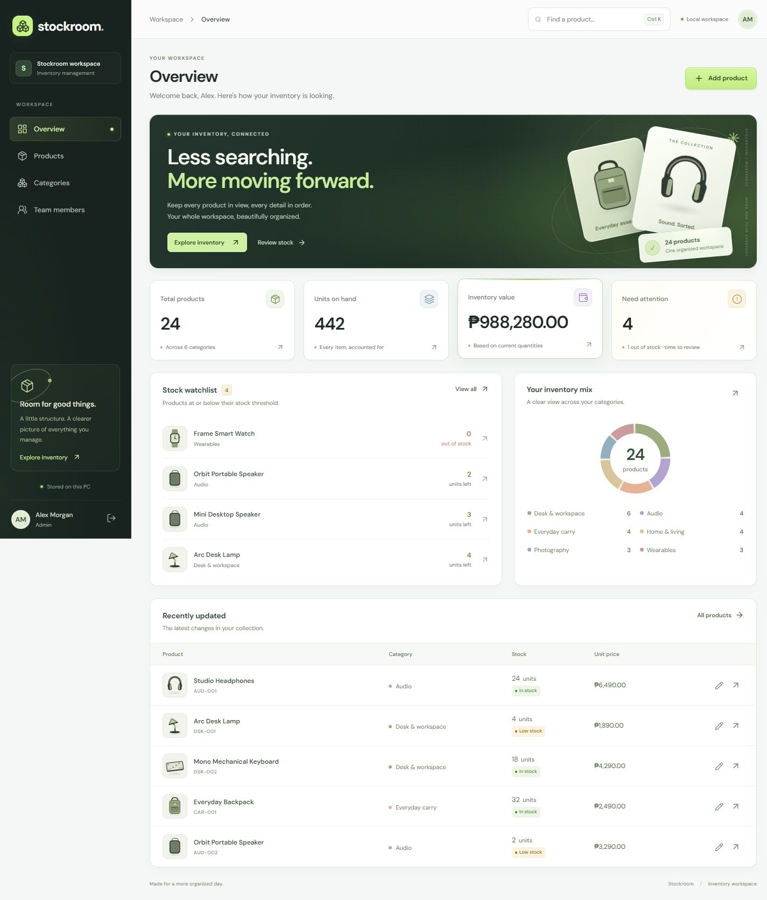

# Stockroom — FinalTermLaravel

A local inventory workspace built for the final project: Laravel MVC, React through Inertia, Fortify authentication, and Spatie roles and permissions.

It runs in a browser on your own PC. GitHub stores the source code; it does not host the running app or share the database. No SaaS accounts, paid APIs, mail service, or online deployment are needed.

**Project owner:** Basty Mirafelix · [mrflxbast1](https://github.com/mrflxbast1) · mirafelixjohnbasty@gmail.com



## What it does

- Product and category CRUD, with search, filtering, sorting, and pagination.
- Live inventory totals, category distribution, and low-stock alerts.
- Registration, login, logout, and password reset.
- Admin, Manager, and User roles enforced on the server.
- Responsive charcoal-and-lime interface with floating product tiles, pointer lighting, interactive summary cards, bundled fonts, and reduced-motion support.

## Three project parts

| Part | Main code | Responsibility |
| --- | --- | --- |
| Backend | [Controllers](app/Http/Controllers), [models](app/Models), [database](database) | Inventory, validation, relationships, and dashboard data |
| Frontend | [React pages and components](resources/js), [styles](resources/css) | Screens, forms, navigation, responsive layout, and animation |
| Auth & access control | [Fortify actions](app/Actions/Fortify), [role seeder](database/seeders/RolesAndPermissionsSeeder.php), [auth provider](app/Providers/FortifyServiceProvider.php) | Accounts, password resets, roles, and permissions |

The [team guide](docs/team-parts.md) maps the files, shared boundaries, and presentation responsibilities. All three parts run together as one application.

## Open the portable Windows version

For someone who only wants to use or demonstrate the app:

1. Download **[Stockroom-1.0.0-windows-x64.zip](https://github.com/mrflxbast1/FinalTermLaravel/releases/download/v1.0.0/Stockroom-1.0.0-windows-x64.zip)** from [Releases](https://github.com/mrflxbast1/FinalTermLaravel/releases).
2. Extract the entire ZIP to a writable folder, such as Documents.
3. Double-click **Open Stockroom.cmd**. The browser opens automatically after startup.
4. Sign in with **admin@stockroom.test** / **Stockroom123!**.

The portable download includes PHP, the built interface, and the PHP dependencies. It does not require installing PHP, Composer, Node, Git, or a database server. It targets Windows 10/11 on 64-bit Intel/AMD PCs. If Microsoft's Visual C++ runtime is missing, the launcher offers the official Microsoft installer; that one-time step needs internet and may ask for administrator approval. Normal use is offline.

Keep the Stockroom terminal open while using the app. Press **Q** there or close that window to stop. Double-clicking the launcher while it is running reopens the same app. If port 8000 is busy, the launcher chooses another free port automatically.

Each extracted copy starts with its own fresh database. To back it up, close Stockroom and copy the entire folder, keeping `app/.env` together with `app/database/database.sqlite`. Share the original ZIP when someone needs a fresh installation.

GitHub's **Code → Download ZIP** downloads the source code. It is different from the portable ZIP attached to a Release. See [the portable guide](docs/portable.md) for troubleshooting, rebuilding, and GitHub handoff instructions.

## Run the source code on Windows

### 1. Install the prerequisites once

| Software | Requirement | Download |
| --- | --- | --- |
| PHP | 8.3 or newer, available on PATH | [PHP for Windows](https://windows.php.net/download/) |
| Composer | Version 2, using that PHP installation | [Composer installer](https://getcomposer.org/download/) |
| Node.js | Recommended: 24 LTS. Supported: 20.19+ or 22.12+ | [Node.js](https://nodejs.org/en/download) |
| Git | Optional if you download the ZIP | [Git for Windows](https://git-scm.com/downloads/win) |

On Windows, use PHP's x64 **Non Thread Safe** ZIP for the command-line server. Extract it to a folder such as `C:\php`, copy `php.ini-development` to `php.ini`, and set `extension_dir = "ext"`. Enable these lines by removing their leading semicolons:

```ini
extension=curl
extension=fileinfo
extension=mbstring
extension=openssl
extension=pdo_sqlite
extension=sqlite3
extension=zip
```

The other required extensions usually ship enabled: ctype, dom, filter, hash, pcre, PDO, session, tokenizer, and xml. Setup checks the actual runtime and explains anything missing. PHP also requires the Microsoft Visual C++ Redistributable linked on its download page. Add your PHP folder to your Windows user PATH, then reopen the terminal.

Check that these commands work:

```powershell
php --version
php --ini
composer --version
node --version
npm.cmd --version
```

### 2. Download and set up the project

Download the repository ZIP from GitHub and **extract it**, or clone the repository. Open its folder, then double-click **setup.cmd**. You can also run:

```powershell
.\setup.cmd
```

Setup installs the locked dependencies, creates your local configuration and SQLite database, runs migrations and seeders, and builds the interface. The first setup needs an internet connection. Rerunning it preserves your application key, saved records, passwords, and user roles. Sample data is added only to an empty installation.

### 3. Start it

Double-click **start.cmd**, or run:

```powershell
.\start.cmd
```

Open **http://127.0.0.1:8000**. Keep the terminal window open while using the app. Press Ctrl+C to stop it. After setup, normal use needs PHP and the built files; no Vite server or internet connection is required.

If another app uses port 8000:

```powershell
.\start.cmd -Port 8001
```

Open the URL printed by the script. It binds to your own PC's loopback address.

## Demo accounts

Fresh installations contain 6 categories and 24 sample products. All three demo accounts initially use **Stockroom123!**.

| Email | Role | Access |
| --- | --- | --- |
| admin@stockroom.test | Admin | All inventory actions, category deletion, team roles |
| manager@stockroom.test | Manager | View, create, edit and delete products; create and edit categories |
| user@stockroom.test | User | View dashboard, products and categories |

New registrations receive the User role. Only Admin can change other users' roles, and an Admin cannot change their own role.

## Password reset on a local PC

The project uses Laravel's **log mailer**. Email stays on the PC; it is not sent to an inbox.

1. Choose **Forgot password?** and enter an existing account's email.
2. Open `storage/logs/laravel.log` and find the most recent **Reset Password** message.
3. Copy its full `http://127.0.0.1:8000/reset-password/...` link into the browser.
4. Choose the new password. Links expire after 60 minutes and work once.

You can watch the log in PowerShell:

```powershell
Get-Content .\storage\logs\laravel.log -Tail 100 -Wait
```

Logs contain reset links, so keep them local. The repository ignores logs, `.env`, and database files.

## Where your data lives

The default database is `database/database.sqlite`. Each downloaded copy has its own users and inventory. Git pulls or pushes do not transfer this data.

To back up an installation, stop the app and copy both the database file and `.env` to a private backup folder. Keep the existing `APP_KEY`; do not regenerate it during normal setup or updates.

The Windows launchers also recognize an optional project-local `.tools/php` runtime. This is a convenience on the development PC and is **not included in GitHub**. A downloaded repo uses the prerequisites above.

## Development and tests

For editing React/CSS, use two terminals:

```powershell
composer dev
```

```powershell
npm.cmd run dev
```

For the normal built version, stop Vite, run `npm.cmd run build`, then use `start.cmd`. If Vite was interrupted and left `public/hot`, remove that file after stopping Vite.

```powershell
php artisan test
php vendor/bin/pint --test
npm.cmd run format:check
npm.cmd run build
```

The feature tests use an isolated in-memory SQLite database. They cover authentication, password resets, CRUD, validation, permission boundaries, dashboard calculations, role changes, and safe repeat seeding. They do not modify your local inventory.

### Manual first setup (including macOS/Linux)

Install PHP, Composer and Node first. In a fresh checkout:

```sh
composer install
cp .env.example .env
php artisan key:generate
php -r "file_exists('database/database.sqlite') || touch('database/database.sqlite');"
php artisan migrate --force
php artisan db:seed --force
npm ci
npm run build
php artisan serve --host=127.0.0.1 --port=8000 --tries=1
```

The Windows scripts are the tested installation route. The manual commands follow Laravel's standard workflow; macOS/Linux have not been tested here. On an existing installation, keep `.env`, the database, and `APP_KEY`; skip the copy/key-generation steps.

## Optional MySQL

SQLite is the default and needs no separate database server. If your instructor specifically requires MySQL:

1. Install and start MySQL, create an empty database named `stockroom`, and enable PHP's `pdo_mysql` extension.
2. Set `DB_CONNECTION=mysql`, `DB_HOST=127.0.0.1`, `DB_PORT=3306`, `DB_DATABASE=stockroom`, `DB_USERNAME`, and `DB_PASSWORD` in `.env`.
3. Run `php artisan config:clear`, `php artisan migrate`, then `php artisan db:seed`.

This creates a separate database; it does not move existing SQLite records. The automated suite and clean-install check use SQLite.

## Troubleshooting

- **PHP/Composer not found:** install the prerequisites, check PATH, and reopen your terminal.
- **Could not find driver:** enable `pdo_sqlite` in the configuration shown by `php --ini`.
- **Certificate verification failed:** configure a current CA certificate bundle using PHP's `curl.cainfo` and `openssl.cafile`; do not disable TLS verification.
- **Port occupied:** check whether Stockroom is already running, or use `start.cmd -Port 8001`.
- **Missing Vite manifest:** run setup again, or `npm.cmd ci` followed by `npm.cmd run build`.
- **Blank page after a build:** refresh the browser. For development, check that Vite is running.
- **419 / page expired:** refresh the login form and sign in again.
- **Access restricted:** the signed-in role does not have permission for that action. Try the Admin demo for the full presentation.
- **PowerShell script restrictions:** the CMD wrappers use a process-only execution-policy setting; they do not change your saved Windows policy.

## Project guide

See [the three-part team guide](docs/team-parts.md) for Backend, Frontend, and Auth & Access Control responsibilities, [the rubric map](docs/rubric.md) for the assignment-to-code checklist, and [the presentation guide](docs/presentation.md) for a short demo and architecture explanation. The original assignment is included as `Final Project.docx.pdf`.
